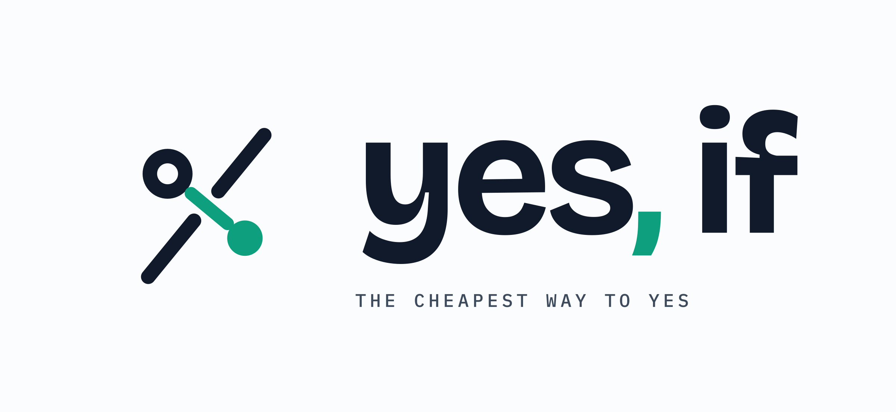
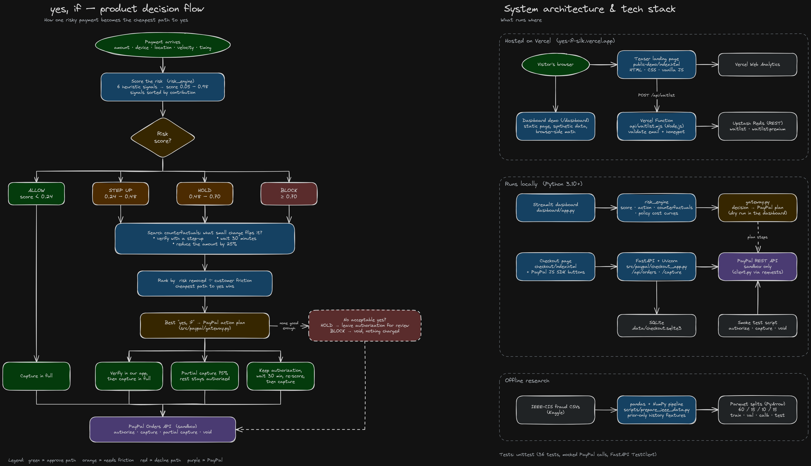

<h1 align="center">yes, if — Counterfactual Payment Risk Engine</h1>

<p align="center">
  Risk engines stop at a score. <strong>yes, if</strong> finds the smallest change that turns a risky payment into an approval, learns which friction is cheapest to apply, and runs the result on PayPal.
</p>

<p align="center">
  <a href="https://yes-if-silk.vercel.app">Live site</a> ·
  <a href="https://yes-if-silk.vercel.app/app">Console</a> ·
  <a href="https://yes-if-silk.vercel.app/docs">API docs</a> ·
  <a href="docs/yes-if-story.mp4">Tutorial video</a>
</p>

---

## Tutorial and flowchart

- **Tutorial video:** [`docs/yes-if-story.mp4`](docs/yes-if-story.mp4) walks through the product end to end.
- **Flowchart:** how one risky payment becomes the cheapest path to yes, plus what runs where. The editable source is [`docs/yes-if-flow.excalidraw`](docs/yes-if-flow.excalidraw); open it at [excalidraw.com](https://excalidraw.com) to change it.



## What it does

For every payment the engine answers four questions:

1. **How risky is it?** A LightGBM detector on causal card history and shared-device ("ring") signals, calibrated with isotonic regression so 0.10 means about 10%.
2. **Why?** Top reasons from path contributions through the trees, in plain language.
3. **What would make it a yes?** A counterfactual search over the 83 changes a buyer can actually make (pay 10–90% now, go through 1–24 hours later, switch debit/credit). It keeps only *minimal* changes (no smaller change also works) and returns the cheapest ones under the approval line.
4. **Which friction is cheapest?** Above the approval line, a learned policy picks step-up, hold or block from the calibrated risk, the amount, and what it has learned about how often each friction catches fraud or loses a good customer.

Every decision and every "yes, if" maps to concrete PayPal calls on an `AUTHORIZE` order: full capture, verification then capture, analyst review, void, partial capture with `final_capture: false`, or a scheduled capture.

## Results

All numbers come from `python -m src.experiments.run_all` (seed 42) on the held-out, later-in-time test split (25,181 payments, 3.1% fraud).

| ID | Experiment | Result |
| --- | --- | --- |
| E1 | Detector: LightGBM vs logistic regression | PR-AUC **0.881** vs 0.785 · ROC-AUC 0.975 vs 0.942 · recall at 1% FPR **86.0%** vs 71.8% |
| E2 | Calibration: raw vs isotonic | ECE 0.0023 → **0.0015** |
| E3 | Shared-entity (graph) features | PR-AUC 0.881 with vs 0.882 without: no gain on this data (device history already carries the ring signal) |
| E4 | Counterfactual quality (400 flagged payments) | Valid "yes, if" for **94%** of flagged legitimate buyers (27% of fraud) · 1.19 features changed · 88% within the card's history |
| E5 | Policy under drift (step-up catch 85% → 40% halfway) | Cost after the drift: **learned friction $15.1k**, LinUCB $15.3k, oracle $15.6k, best static $18.5k (**−19%**). Over the whole stream the stale analytic policy is cheaper ($31.7k vs $32.3k) |
| E6 | Adversarial retraining (5 rounds, 50 queries) | Evasion **27.7% → 6.0–9.0%**, clean PR-AUC stays 0.881–0.891 |
| E7 | Evasion vs query budget (deployed model) | ≤ 7.5% at 100 queries; capped at 5% with coarse output and a 10-query limit |
| — | Fairness: false-positive rate by segment | Device type 3.3% / 3.3% · debit 3.1% vs credit 3.5% · product C 6.5% (highest) |

### Read this before quoting the numbers

- **Synthetic data.** The model is trained on a reproducible generator (`src/data/synth.py`) in the IEEE-CIS column layout, with account takeover, card testing, device rings and "stealth" fraud on the victim's own device. Set `data.source: ieee` in `config.yaml` to use the real IEEE-CIS files (Kaggle account required).
- **Simulated friction.** No public dataset records step-up, hold or block outcomes, so they come from stated, configurable assumptions (`config.yaml → policy.sim`). A real rollout would start in shadow mode, then an A/B test with off-policy evaluation.
- **Counterfactuals describe the model**, not causal truth: "the model would accept this if…". Buyers only get coarse guidance; exact scores and options are analyst-only and rate-limited.
- No LLM makes or changes any decision.

## Architecture

```
raw payment ─▶ M1 causal history + M3 shared-entity features ─▶ M2 LightGBM + isotonic ─▶ risk
                                                   ▲ M6 adversarial retraining              │
                                                   │                                        ▼
                    M5 learned friction policy ◀── context + risk ── M4 counterfactual search
                                   │
                                   ▼
          M7 FastAPI (user / analyst views) ─▶ PayPal sandbox (authorize → capture / void)
                                   │
                    website + console (Vercel) · Streamlit dashboard (M8) · reports (M9)
```

| Module | Code |
| --- | --- |
| M1 Data and features | `src/data/` (`synth.py`, `load.py`, `features.py`, numpy-only `core.py` shared by training and serving) |
| M2 Detector and calibration | `src/models/detector.py`, `metrics.py`, numpy predictor `serving.py` (exact parity with LightGBM is tested) |
| M3 Graph features | `add_graph_feats` in `src/data/features.py` |
| M4 Counterfactual engine | `src/counterfactual/search.py` |
| M5 Friction policy | `src/policy/` (simulator, baselines B1–B3, LinUCB, learned-friction Thompson sampling) |
| M6 Adversary loop | `src/adversary/attacker.py`, loop in `src/experiments/run_all.py` |
| M7 Serving API | `src/api/main.py` (Vercel entry: `api/index.py`) |
| M8 Dashboard | `public/app.html` (hosted console) and `dashboard/app.py` (Streamlit) |
| M9 Evaluation | `src/experiments/run_all.py` → `reports/results.json` |
| Decision layer | `risk_engine/` (`RiskEngine.load().decide(tx, view)`) |
| PayPal | `src/paypal/client.py` (sandbox-only REST client), `gateway.py` (decision → plan) |

Design choices beyond the build plan, each made after the plan's version underperformed:

- **Monotone constraints** on amount (+) and funding source (debit never riskier than credit), so a counterfactual never says "pay more to be approved".
- **Adversarial rows come from training-period fraud**, not validation fraud: the plan's loop also early-stops on validation, which leaked and collapsed the model (PR-AUC 0.06).
- **Learned friction policy.** LinUCB with the plan's context lost to every static baseline. Its replacement learns each friction's catch and abandonment rates from observable outcomes (a failed verification, a chargeback, an abandoned checkout) with discounted Thompson sampling. LinUCB is still reported, with a context that is linear in expected cost.

## Run it

**Requirements:** Python 3.12.

```bash
git clone https://github.com/spongebob2005/yes-if-counterfactual-risk-engine.git
cd yes-if-counterfactual-risk-engine
python -m venv .venv && source .venv/bin/activate
python -m pip install -r requirements-dev.txt

python -m src.experiments.run_all          # data → model → experiments → models/ + reports/ (~1 minute)
uvicorn src.api.main:app --reload          # API + website on http://127.0.0.1:8000
streamlit run dashboard/app.py             # offline dashboard
python -m unittest discover -s tests       # 60 tests
```

`requirements.txt` holds only what the deployed API needs (FastAPI, numpy, requests, python-dotenv); training and the dashboard use `requirements-dev.txt`.

### API in one call

```bash
curl -X POST "https://yes-if-silk.vercel.app/api/decide?view=analyst" \
  -H "Content-Type: application/json" \
  -d '{"TransactionAmt": 834, "TransactionDT": 13910400, "card6": "credit", "prior_cnt": 30,
       "prior_mean_amt": 95, "prev_dt": 13800000, "card_device_prior": 12, "DeviceInfo_distinct_uids": 1}'
```

`view=user` (default) returns only `action` and `guidance`. See [/docs](https://yes-if-silk.vercel.app/docs) for every field and endpoint.

### PayPal sandbox checkout

The console's **Sandbox checkout** tab scores a demo buyer before PayPal opens, creates an `AUTHORIZE` order for a server-side catalog price, and runs the engine's plan after approval. Depending on the decision, the plan captures, asks for a one-time code, holds for review, or offers a "yes, if" (part now, the rest later). Blocked buyers never reach PayPal.

Local setup: create `.env` with `PAYPAL_CLIENT_ID` and `PAYPAL_CLIENT_SECRET` from a PayPal developer **sandbox** app. Never commit it. Orders are stored in SQLite locally (`.data/`) and in Upstash Redis on Vercel. `scripts/paypal_smoke_test.py` exercises authorize → capture / partial capture / void from the terminal.

## Deploy

Vercel serves `public/` as static files and `api/index.py` (FastAPI) as a Python function; `api/waitlist.mjs` stays a Node function. `vercel.json` rewrites every `/api/*` path except the waitlist to the Python app. Required environment variables: `PAYPAL_CLIENT_ID` and `PAYPAL_CLIENT_SECRET` (sandbox), plus `KV_REST_API_URL` and `KV_REST_API_TOKEN` from the Upstash integration.

## Important: demo only

Trained on synthetic data with simulated intervention outcomes, and connected to the PayPal sandbox only. Do not use it to approve, decline or investigate real payments.

## License

[MIT](LICENSE)
